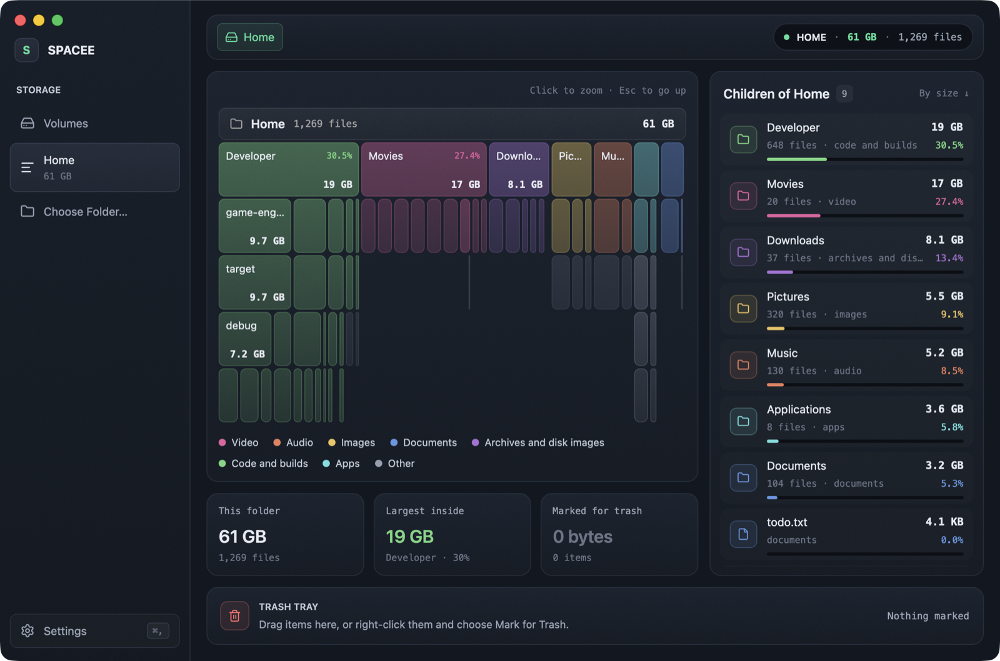

<div align="center">

# Spacee

**See what uses the disk space on your Mac, and move it to the Trash.**

A native macOS disk-usage app, written in Rust with [GPUI](https://www.gpui.rs/).

[](#requirements)
[](https://www.rust-lang.org/)
[](https://www.gpui.rs/)
[](LICENSE)



</div>

## Features

- **Icicle chart.** Each folder and file is a block. The width of a block shows its size on disk. The colour shows its type: video, audio, images, documents, archives and disk images, code and builds, apps, or other. Click a block to zoom in. To go up, click the bar at the top or push Esc.
- **Live scan.** The chart grows during the scan. The app shows the size found, the number of files, the files per second and the time since the start. For a full volume, it also shows the estimated time to completion.
- **Volumes.** The startup disk shows first, with its free space and status. Other drives, disk images and network shares show below it. Each volume has a Scan button. To scan a folder, drop it on the window or click Choose Folder….
- **Trash tray.** Drag blocks or list rows into the Trash tray, or right-click an item and choose Mark for Trash. Then click Move to Trash. Spacee moves items to the Trash only. It never deletes them permanently. The sizes update without a new scan.
- **Finder actions.** The right-click menu has Reveal in Finder, Quick Look and Copy Path. The space bar opens Quick Look for the item under the pointer.
- **Unaccounted space.** A scan of a full volume adds a grey "Unaccounted space" item. It shows the space that the volume reports as used but that no scanned file uses: snapshots, purgeable space, the other volumes in the APFS container, and folders that Spacee cannot read.
- **Dark and light appearance.** Spacee follows the system appearance. To set it manually, open Settings (⌘,).

[docs/ARCHITECTURE.md](docs/ARCHITECTURE.md) describes how the app works.

## Requirements

- macOS 13 or later
- Rust 1.92 or later (`rustup update stable`)
- Xcode. The Command Line Tools are not sufficient, because GPUI compiles its Metal shaders during the build and `scripts/run.sh` uses `actool` for the icon.
- Optional: a code-signing certificate, to keep Full Disk Access after each build (see [Signing](#signing))

## Quick start

```sh
git clone https://github.com/reinislejnieks/spacee.git
cd spacee
scripts/run.sh
```

| Command | Result |
| --- | --- |
| `scripts/run.sh` | Debug build. Makes, signs and opens the app. |
| `PROFILE=release scripts/run.sh` | Release build |
| `scripts/run.sh --no-open` | Makes and signs the app, but does not open it |

The app bundle is `target/<profile>/Spacee.app`. To start a scan of a folder immediately, give its path to the binary in the bundle:

```sh
target/release/Spacee.app/Contents/MacOS/spacee ~/Downloads
```

Spacee saves its settings in `~/Library/Application Support/com.rlejnieks.spacee/settings.json`.

## Install

This command makes a release build and copies it to `/Applications`. If Spacee is open, the command quits it first. The command replaces an earlier copy.

```sh
./manage install
```

To make a disk image with a shortcut to Applications:

```sh
scripts/dmg.sh    # makes target/release/Spacee-<version>.dmg
```

The disk image is not notarized. Gatekeeper on other Macs blocks it. To share a build, sign it with a Developer ID Application certificate and notarize it.

### Full Disk Access

Without Full Disk Access, macOS hides parts of `~/Library` and other protected folders. The totals are then smaller than the real values. While Spacee does not have access, the volumes screen and the scan results show a Grant Full Disk Access… button. To give access:

1. Open System Settings > Privacy & Security > Full Disk Access.
2. Add `Spacee.app`.
3. Quit and open Spacee again.

macOS ties the access to the signing identity of the app. A build signed with the same certificate keeps the access. An ad-hoc signed build loses it after each rebuild.

## Signing

`scripts/run.sh` signs the app with the certificate in `SPACEE_SIGN_IDENTITY`. `./manage install` and `scripts/dmg.sh` use `scripts/run.sh`. If `SPACEE_SIGN_IDENTITY` is not set, the app is signed ad hoc. The app works, but it loses Full Disk Access after each rebuild.

To sign with your certificate:

```sh
security find-identity -v -p codesigning     # shows the certificates and their 40-character hashes
SPACEE_SIGN_IDENTITY=<hash> scripts/run.sh
```

Use the hash, not the name. If two certificates in the keychain have the same name, `codesign` does not accept the name. To use the certificate for each build, add `export SPACEE_SIGN_IDENTITY=<hash>` to your shell profile.

## Command-line scanner

The scanner also runs without the app. It shows the total of a folder and its 20 largest items:

```sh
cargo run --release -p scan -- ~/Downloads
```

Its totals are the same as `du -skx` for the same folder.

## Development

```sh
cargo test --workspace
cargo clippy --workspace --all-targets
cargo fmt
```

The pre-commit hook in `.githooks` runs `cargo fmt --check` and `cargo clippy -- -D warnings`. If one of them fails, the hook stops the commit. To enable the hook, run this command once in each clone:

```sh
git config core.hooksPath .githooks
```

Set `SPACEE_PERF=1` to log the paint time of the chart for each frame.

The app icon is in `crates/app/AppIcon.icon`, an Icon Composer package with a light and a dark version. `scripts/icon.py` draws it and needs Pillow. To change the icon, edit the script and run it again. `scripts/run.sh` compiles the icon with `actool` into `Assets.car` for macOS 26, which uses the light or dark icon to match the appearance, and into `AppIcon.icns` for earlier macOS versions.

The workspace has three crates. [docs/ARCHITECTURE.md](docs/ARCHITECTURE.md) gives more data.

| Crate | Function |
| --- | --- |
| `crates/scan` | Walks the file system in parallel and makes the size tree. Counts allocated bytes, counts hard links once, does not follow symbolic links and does not go into other volumes. |
| `crates/icicle` | Makes the chart geometry from the tree, merges small items into "Smaller objects", finds the block under the pointer and calculates the zoom animation. Has no UI code. |
| `crates/app` | The GPUI app: window, chart, volumes screen, scan screen, folder list and Trash tray. |

## License

Spacee is free software under the [GNU General Public License v3.0 or later](LICENSE). You can use, study, change and share it, also for commercial use. If you distribute a changed version, you must release its source code under the same license.

Spacee has no warranty. It moves items to the Trash only. You can restore an item from the Trash until you empty the Trash.
